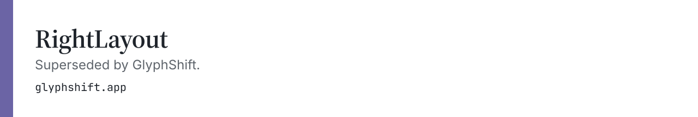

<a href="https://glyphshift.app/">
<picture>
  <source media="(prefers-color-scheme: dark)" srcset="https://raw.githubusercontent.com/chernistry/RightLayout/main/assets/brand/header-dark.svg">
  <source media="(prefers-color-scheme: light)" srcset="https://raw.githubusercontent.com/chernistry/RightLayout/main/assets/brand/header-light.svg">
  
</picture>
</a>

[English](README.md) | [Русский](README.ru.md)

<div align="center">

# RightLayout

**Печатайте свободно.**

RightLayout исправляет ошибки раскладки клавиатуры ещё до того, как вы их заметите.

[Скачать для Mac](https://github.com/chernistry/RightLayout/releases/latest) · [Сайт](https://alexchernysh.com/rightlayout)

---

*[English](README.md) · [Русский](README.ru.md) · Hebrew*

*macOS 13+ · Бесплатно · Open Source*

</div>

---

> **Проект теперь поддерживается сообществом. Автор больше не ведёт активную разработку. Приветствуем вклад!**

---

## Как это работает

Вы печатаете в неправильной раскладке — RightLayout мгновенно исправляет текст с помощью локального ИИ (CoreML).

```
ghbdtn  →  привет
руддщ   →  hello  
akuo    →  שלום
```

Никаких горячих клавиш. Никаких уведомлений. Просто правильный текст.

---

## Возможности

**Работает незаметно**  
Без всплывающих окон и без прерываний. Исправления происходят по мере набора.

**Определение языка на ИИ**  
Модель CoreML, обученная на реальных многоязычных данных набора, с высокой точностью распознаёт текст в неправильной раскладке.

**Учится у вас**  
Отмените исправление дважды — RightLayout запомнит. Он подстраивается под ваш стиль письма.

**Остаётся приватным**  
Всё работает на вашем Mac. Ничего не покидает устройство. Никогда.

**Поддержка нескольких раскладок**  
Поддерживаются английская, русская и ивритская раскладки; архитектура расширяема для добавления новых языков.

---

## Установка

1. Скачайте `.pkg` из [Releases](https://github.com/chernistry/RightLayout/releases/latest)
2. Запустите установщик
3. При запросе выдайте разрешение Accessibility
4. Готово — RightLayout работает в фоне

---

## Сборка из исходников

```bash
git clone https://github.com/chernistry/RightLayout.git
cd RightLayout
swift build
swift test
```

Требуются macOS 13+, Xcode 15+, Swift 5.10+.

См. [CONTRIBUTING.md](CONTRIBUTING.md) — настройка окружения, стиль кода и добавление новых языков.

---

## Ищем мейнтейнеров

Проекту нужны новые мейнтейнеры. Если вам интересны разработка под macOS, обработка ввода с клавиатуры или определение языка на CoreML — это отличный проект, чтобы взяться за него.

**Чем занимается мейнтейнер:**
- Разбирать и отвечать на issues
- Ревьюить и принимать pull requests
- Выпускать новые релизы
- Расширять поддержку языков (немецкий, французский, арабский и т.д.)

Если интересно — откройте issue с заголовком «Maintainer interest» и расскажите о своём опыте. Никаких привратников: хорошие PR — и вы получаете права на коммиты.

---

## Архитектура

- `RightLayout/Sources/Engine/` — ядро исправлений (определение языка, маппинг раскладок, маршрутизация по уверенности)
- `RightLayout/Sources/UI/` — настройки на SwiftUI и интерфейс в строке меню
- `RightLayout/Sources/Settings/` — пользовательские предпочтения и персонализация
- `Tools/CoreMLTrainer/` — Python-пайплайн обучения классификатора языка для CoreML

Подробности по добавлению функций и языков — в [CONTRIBUTING.md](CONTRIBUTING.md).

---

## Лицензия

Apache-2.0 — см. [LICENSE](LICENSE). Использование названия проекта: [TRADEMARKS.md](TRADEMARKS.md).

---

<div align="center">

Создано [Alex Chernysh](https://alexchernysh.com)

</div>

Перевод основан на [README.md из коммита cdb5e3126550c6432cee421b20e7050537aff9a0](https://github.com/chernistry/RightLayout/blob/cdb5e3126550c6432cee421b20e7050537aff9a0/README.md).
